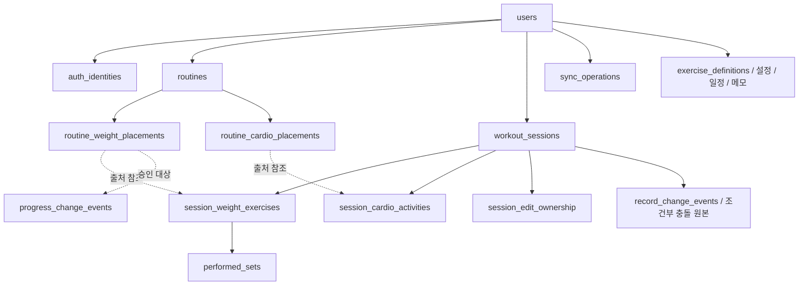

# Task 006-A — TypeScript 모델과 PostgreSQL 논리 모델 대응 분석

- 분석일: 2026-10-27 (Asia/Seoul)
- 상태: **분석 완료 / 논리 스키마 최종 확정 전 검토안**
- 범위: 문서 작성만 수행. 운동 코드·타입·로컬 데이터·백엔드 구현·의존성·DDL·API 변경 없음. Commit/Push/배포 없음.
- 분석 시작 Git 상태: 양쪽 저장소 모두 변경 없음. 분석 기준 HEAD: 서버 `db69c83`, 프론트엔드 `88e0d02`.

## 1. 결론과 근거의 구분

**현재 코드에서 확인한 사실:** `WorkoutState`는 계정 없는 단일 localStorage 문서다. 루틴 복사본, 실제 완료 세트, 유산소 자동 시간/정정 시간, 승인 중량과 독립 승인 사건은 이미 구분한다. 그러나 독립적인 세션 웨이트 종목 ID, 변경되지 않는 운동 시작 계획, 기록 정정/삭제 이력, 서버 소유권·버전·멱등성·제어권·초기화 세대는 없다. 백엔드는 Health API와 테스트만 있고 데이터 계층은 없다. [F01–F06, B01–B04]

**사용자가 확정한 신규 제품 정책:** 완료 수행값의 명시적 수정과 개별 수행/완료 세션 삭제, 당시 계획 수정 금지, 정정 전후·변경 시각 보존, 현재 기준 재평가, 기존 승인 사건 자동 변경 금지, 오래된 전송으로 삭제 데이터 부활 금지다. 로컬 우선·단일 수정 기기·명시적 정상/강제 제어권 이전·차이 비교/선택 복구·전체 초기화 이전 세대 거부도 확정 요구사항이다. 구현 완료를 뜻하지 않는다. [P01 R-07/10절, P02, P04, 이번 Task 006-A 요청 4–6절]

**Codex가 제안하는 기술 설계안:** 실제 수행은 관계형 데이터, 시작 당시 계획과 종료 당시 적용 계획/판단은 버전 있는 JSONB 스냅샷으로 분리한다. 루틴과 세션에 집계 단위 `version`을 두고, 진행 중 세션에 `ownership_epoch`, 사용자에 `data_generation`, 요청에 `operation_id`, 삭제 대상에 Tombstone을 추가한다. 각 값은 서로 다른 위험을 막으며 대체 관계가 아니다. 이 보고서의 테이블·컬럼·트랜잭션·오류 처리 방식은 모두 **후속 확정이 필요한 제안**이다.

### 1.1 분석 자료와 소스 위치

아래 식별자는 본문의 근거 참조다. `F`는 `overload-pwa`, `B`는 `overload-server` 소스이며, 링크는 실제 파일로 연결된다. 대응표의 F01은 타입 선언, F02 등은 실제 저장·변경 의미를 확인한 구현 위치다.

| ID | 확인한 파일 | 분석 범위 |
| --- | --- | --- |
| R01 | [서버 AGENTS.md](../../AGENTS.md), [backend.md](../engineering/backend.md) | 최소 변경, 데이터 무결성, 트랜잭션, Decimal/시각, 승인·검증·보고 규칙 |
| R02 | [프론트엔드 AGENTS.md](../../../overload-pwa/AGENTS.md), [frontend.md](../../../overload-pwa/docs/engineering/frontend.md) | 로컬 보존, 계정 격리, 실제 의존성 확인. 두 AGENTS.md의 SHA256 동일 확인 |
| P01 | [제품 요구사항](../../../overload-pwa/docs/product/requirements.md) | 2026-10-27 보완 R-01–R-08, 8–10절. 운동·인증·동기화 정책 기준 |
| P02 | [인증·계정 정책](../../../overload-pwa/docs/product/auth-preview.md) | 확정 정책, 잠정 기간, 목업 값, 초기화/탈퇴/개발 데이터 경계 |
| P03 | [UI/UX](../../../overload-pwa/docs/product/ui-ux.md) | 유산소 및 Task 005.5 최종 정책 UX(7–9절) |
| P04 | [Task 006 설계 인계](../../../overload-pwa/docs/handoff/Overload-Task006-Design-Handoff.md) | 최신 정책/미구현 경계, 12개 설계 대상, 수용 시나리오 |
| P05 | [Task 001–005 인계](../../../overload-pwa/docs/handoff/Overload-Project-Handoff-Task001-005.md) | 5–7절 운동/유산소/저장 이력. 최신 정책에 우선하지 않는 역사 자료 |
| P06 | [Task 005.5 보고서](../../../overload-pwa/docs/tasks/task-0055-auth-preview-report.md) | 목업 격리·당시 검증 범위. 운영 동기화 구현 증거로 사용하지 않음 |
| F01 | [workout/types.ts](../../../overload-pwa/src/features/workout/types.ts) | 모든 운동 타입과 실제 필드 |
| F02 | [workout/model.ts](../../../overload-pwa/src/features/workout/model.ts) | 초기화, 루틴 CRUD, 세션, 세트, 승인 사건, 기준/권고/요약 |
| F03 | [workout/storage.ts](../../../overload-pwa/src/features/workout/storage.ts) | `overload.core.v1`, 검증·로드·단일 저장·승인 실패 처리 |
| F04 | [workout/useWorkout.ts](../../../overload-pwa/src/features/workout/useWorkout.ts) | 메모리/저장 오류, 다중 탭 차단, 재시도 |
| F05 | [workout/cardio.ts](../../../overload-pwa/src/features/workout/cardio.ts) | 계획 범위·기구별 입력, 상태 전이·타이머·결과 |
| F06 | [workout/id.ts](../../../overload-pwa/src/features/workout/id.ts), [reps.ts](../../../overload-pwa/src/features/workout/reps.ts), [weight.ts](../../../overload-pwa/src/features/workout/weight.ts) | UUID, 반복 횟수, 중량 초안과 소수 증감 |
| F07 | [App.tsx](../../../overload-pwa/src/App.tsx), [RoutineEditor.tsx](../../../overload-pwa/src/features/routine/RoutineEditor.tsx), [CardioPlanEditor.tsx](../../../overload-pwa/src/features/routine/CardioPlanEditor.tsx) | 종목 정의 추가, 요일/선택 상태, 편집 초안·명시 승인, 분→초 변환 |
| F08 | [WorkoutScreen.tsx](../../../overload-pwa/src/features/workout/WorkoutScreen.tsx), [CardioScreen.tsx](../../../overload-pwa/src/features/workout/CardioScreen.tsx), [ResumeWorkoutCard.tsx](../../../overload-pwa/src/features/workout/ResumeWorkoutCard.tsx) | 모달 중량 초안, 종목 전환·복원 상태 표시 |
| F09 | [SessionDetail.tsx](../../../overload-pwa/src/features/history/SessionDetail.tsx), [ProgressionHistory.tsx](../../../overload-pwa/src/features/history/ProgressionHistory.tsx) | 당시 판단 재계산/현재 판단/승인 사건 표시. 완료 이력 편집·삭제 UI 없음 |
| F10 | [auth-preview/model.ts](../../../overload-pwa/src/features/auth-preview/model.ts), [main.tsx](../../../overload-pwa/src/main.tsx) | `PreviewState`/`Account` 등 메모리 목업, DEV 분기 격리 |
| F11 | [package.json](../../../overload-pwa/package.json), [package-lock.json](../../../overload-pwa/package-lock.json) | 실제 scripts/의존성. Node test 사용, 예정 도구를 도입됐다고 간주하지 않음 |
| T01 | [workout.test.mjs](../../../overload-pwa/tests/workout.test.mjs) | 루틴/세션 격리, 단일 세션 기준, 승인 원자성, 계획 수, 이력 판단 |
| T02 | [cardio.test.mjs](../../../overload-pwa/tests/cardio.test.mjs) | 유산소 상태·단위·정정·건너뛰기·구 v1/손상 저장 호환 |
| T03 | [reps.test.mjs](../../../overload-pwa/tests/reps.test.mjs), [weight.test.mjs](../../../overload-pwa/tests/weight.test.mjs) | 새 완료 1회 이상, 구 0회 읽기, 정확한 초안 증감 |
| T04 | [components.test.mjs](../../../overload-pwa/tests/components.test.mjs), [auth-preview.test.mjs](../../../overload-pwa/tests/auth-preview.test.mjs) | 계획/완료/초안 표시 및 목업의 계정 격리 시나리오. 서버 보안 테스트 아님 |
| B01 | [build.gradle](../../build.gradle), [Gradle Wrapper](../../gradle/wrapper/gradle-wrapper.properties) | Java 25, Boot 4.1.2, Gradle 9.8.2. JPA/PostgreSQL 주석 처리 |
| B02 | [HealthController.java](../../src/main/java/com/overload/overload_server/health/HealthController.java), [HealthResponse.java](../../src/main/java/com/overload/overload_server/health/HealthResponse.java) | `GET /api/v1/health` → `{ "status": "UP" }` |
| B03 | [application.yaml](../../src/main/resources/application.yaml) | 앱 이름만 설정. 데이터소스/보안/세션 설정 없음 |
| B04 | [HealthControllerTests.java](../../src/test/java/com/overload/overload_server/health/HealthControllerTests.java), [ApplicationTests](../../src/test/java/com/overload/overload_server/OverloadServerApplicationTests.java) | GET 200/POST 405 및 컨텍스트 테스트 정의 확인 |

서버에는 작업 전 `docs/product/`, `docs/tasks/`, `docs/handoff/`가 없었다. 제품 기준은 프론트엔드의 위 문서에서 확인했고, 서버 분석 보고서를 위해 `docs/tasks/`에 이 파일만 추가한다. 이번 요청의 Resend·Spring Session JDBC·쿠키 방향은 기존 인계 문서보다 구체적인 **사용자 확정 입력**으로 반영한다.

## 2. 현재 TypeScript 구조와 저장 동작 — 코드에서 확인한 사실

### 2.1 최상위 구조

`WorkoutState = { version: 1, definitions, routines, schedule, progress, benchmarks, memos, restSettings, active, history, progressChanges? }`이다. `saveWorkout`이 객체 전체를 JSON.stringify하여 단일 키에 쓴다. `version`은 로컬 문서 형식이며 서버 수정 버전이 아니다. `active`는 최대 하나지만 계정·기기 전체에서 하나라는 보장은 아니다. [F01, F03]

- `loadWorkout`: 키 부재면 예시 루틴·종목·일정·진행 중량이 있는 `createInitialState()`를 반환한다. 로드만으로 쓰지는 않는다. 파싱/형식/저장소 접근 실패면 초기 화면용 상태와 `blocked: true`를 반환하고 원문을 덮어쓰지 않는다.
- 선택 필드 `progressChanges`, 루틴/세션 `cardio`, `plannedSetCount`를 구 v1에 강제로 채우거나 다시 저장하지 않는다. 조회 측에서 없는 배열을 빈 값으로 해석한다. 과거 승인 사건을 추정 생성하지 않는다. [F02–F05, T01–T03]
- 일반 쓰기 실패는 다음 메모리 상태를 유지한다. 승인 사건 수가 증가한 변경의 쓰기 실패는 이전 상태로 되돌려 승인 값과 사건을 함께 거부한다. 이는 `persistWorkoutUpdate`의 사건 수 비교에 의존한 현행 구현이며 일반적인 DB 트랜잭션/분산 원자성 구현이 아니다.
- 승인 실패 후 재시도는 저장소 재확인일 뿐 거부된 승인을 자동 적용하지 않는다. 승인 모달/루틴 편집 초안은 컴포넌트 메모리에 남고 사용자가 다시 승인한다. 일반 초안도 새로고침 전까지만 메모리 보존될 수 있다. [F03, F04, F07, F08, T01 `failed atomic approvals...`]
- `storage` 이벤트의 같은 키 또는 전체 clear에 반응해 편집을 차단한다. 로컬 변경 버전/CAS가 없으므로 동시 쓰기의 모든 경쟁을 막는 잠금은 아니다. 서버 제어권·다중 기기 동기화는 없다. [F04]
- `newId()`는 `crypto.randomUUID()` 또는 `getRandomValues` 기반 UUID v4를 사용한다. 단, 초기 `push`, `bench`, `push-bench` 등은 **UUID가 아닌 문자열**이다. 타입 검증도 UUID 형식을 강제하지 않는다. [F02 `createInitialState`, F06, T01]

### 2.2 루틴·세션·실제 수행

- 종목 정의 `ExerciseDefinition.id`와 루틴 배치 `RoutineExercise.id`는 다르다. 순서는 별도 필드 없이 배열 순서다. 요일은 `schedule[0..6] = routineId`이고 일요일 ID가 0이다. `progress`는 종목 정의가 아닌 배치 ID별 승인 중량이다. [F01, F02, F07]
- `startWorkout`은 루틴 설정/이름/승인 중량/기준 반복을 복사한다. 세션 ID와 세트 ID는 새로 만든다. **웨이트 `WorkoutExercise.id`는 루틴 배치 ID를 그대로 재사용**한다. 세션 한정 추가 종목만 새 ID를 갖는다. 유산소는 새 `CardioActivity.id`와 복사한 `plan.id`를 구분한다. [F02 `createWorkoutExercise/startWorkout/addSessionExercise`, F05 `createCardio`]
- 루틴 수정/삭제는 기존 active/history를 바꾸지 않는다. 삭제는 루틴과 일정만 제거하며 `progress`, `benchmarks`, 사건을 정리하지 않는다. 따라서 현재 로컬 참조는 SQL의 필수 FK보다 느슨하다. [F02 `saveRoutine/deleteRoutine`, T01, T02]
- 세션은 독립 복사본이지만 **시작 계획과 운동 중 변경 후 계획의 별도 불변 복사본은 없다.** `approvedWeight`, `weight`, `benchmark`, `sets`는 운동 중 변경된다. `structureModified`는 세트 추가/제외 및 당일 종목 추가의 자격 표시이지 변경 내역 전체가 아니다.
- `WorkoutSet.reps`는 문자열 초안이다. 실제 수행은 `actual !== null`인 `{weight,reps,completedAt,temporaryWeight}`다. 새 완료는 1 이상의 안전한 정수, 목표 상한 초과 허용. 읽기는 과거 `actual.reps = 0`도 허용한다. actual을 취소한 뒤 초안을 편집할 수 있다. [F02 `completeSet/undoSet`, F03, F06, T03]
- 종료는 명시적 `finishWorkout`이다. 부분 종료는 확인이 필요하고 미완료 유산소는 건너뜀으로 마감한다. `plannedSetCount`에 **종료 직전 적용 세트 수**를 넣은 뒤 미완료 웨이트 세트를 제거한다. 원래 ordinal은 재번호하지 않는다. 빈 실제 세트 목록을 가진 세션 종목도 남을 수 있다. [F02, T01, T02]
- 워밍업은 기록 없는 `phase='warmup'`, 본운동은 `working`, 종료는 `finished`다. 휴식/전환은 `timer.kind`이며 별도 phase가 아니다. 전부 수행한 뒤의 `운동 종료 대기`는 미완료 여부에서 파생한다. `rest.endAt`, `transition.since` 및 실제 완료 앵커로 복원하며 현재 시각은 매초 메모리 화면만 갱신한다. `restoredAt` 같은 영속 복원 시각 필드는 없다. [F01, F02 `resolveWorkoutTimer`, F07, F08]

### 2.3 유산소

`ready → running ↔ paused → review → completed`, review 취소는 paused, 미완료 종료는 skipped다. 목표 도달은 자동 완료가 아니다. running/review는 한 세션에 동시에 최대 한 활동만 허용한다. [F05, T02]

- 활동 시간 = `accumulatedMs + max(0, now-runSince)`(running일 때). pause/review에서 누적하고 `runSince=null`로 바꾼다. 매초 쓰거나 전송할 필요가 없다.
- 계획은 목표 초, 선택 거리 km, 속도 km/h 또는 페이스 분/km, 경사 %, 기구 저항이다. `targetSeconds`는 초 정수이고 UI 분 입력을 반올림한다. 실제 속도/페이스·GPS·자동 심박 필드는 없다.
- `draft`는 문자열이다. 확인 후 `result.timerMs`는 자동 누적 원본, `activeMs`는 채택 실제 시간, `corrected`는 수동 시간 정정 여부다. 거리와 BPM은 수동 선택값이고 미입력은 null이다. 계획으로 실제 거리를 추정 생성하지 않는다.
- skipped는 `result=null`; `startedAt=null` 여부로 미시작과 시작 후 미완료를 구별한다. 누적 시간은 남아도 실적으로 집계하지 않는다. 완료 결과와 초안은 현재 저장 객체에 함께 남을 수 있다. 웨이트 볼륨·기준에는 포함하지 않는다. [F01, F05, F09, P01 8절]

## 3. TypeScript ↔ PostgreSQL 필드 대응표

아래 오른쪽 전체는 **기술 설계 제안**이다. `저장`은 현재 localStorage 값, `파생`은 현재 계산 결과, `UI`는 컴포넌트 메모리만 뜻한다. 현재 저장된 값이라도 모두 DB 영속 대상은 아니다. `U/R/S/E/A`는 인증된 사용자/루틴/세션/세션 웨이트 종목/유산소 활동이다. 모든 사용자 데이터는 U 범위이며 하위 소유권은 7절의 복합 FK와 서비스 검증을 함께 적용한다. 스냅샷/초안 JSONB는 형식 버전을 별도로 갖는다.

### 3.1 최상위·보조 데이터

| TypeScript 타입 | 실제 필드 | 소스 | 현재 역할 | 영속 여부 | PostgreSQL 후보 | 저장 형태 | 변경 정책 | 소유권 | 검토 사항 |
| --- | --- | --- | --- | --- | --- | --- | --- | --- | --- |
| WorkoutState | version | F01/F03 | 로컬 schema v1 | 저장 | 직접 대응 없음; snapshot_schema_version 별도 | 로컬 메타/JSONB 형식 | 형식 전환 때 | 로컬 계정 영역 | row version/data_generation과 구분 |
| WorkoutState | definitions | F01/F07 | 기본/추가 종목 정의 | 저장 | exercise_definitions | 관계형 | 명시 편집 | U | 공유 카탈로그 여부 미정; 현재 목록에 출처 필드 없음 |
| ExerciseDefinition | id / name | F01/F02 | 종목 식별/표시명 | 저장 | exercise_definitions.id/name | UUID/text | ID 불변, 이름 수정 가능 | U | 이름은 PK/전역 UNIQUE 아님; 역사 이름 별도 |
| WorkoutState | routines | F01/F02 | 루틴 목록 | 저장 | routines 및 두 배치 테이블 | 관계형 | CRUD | U/R | 배열 표시 순서 필요 시 position |
| WorkoutState | schedule | F01/F02/F07 | 요일당 기본 루틴 1개 | 저장 | weekly_schedule.weekday/routine_id | 관계형 | 명시 교체 | U→R | 사용자+요일 UNIQUE; 휴식은 행 부재 |
| WorkoutState | progress | F01/F02 | 배치 ID→승인 현재 중량 | 저장 | routine_weight_placements.approved_weight | NUMERIC 컬럼 | 명시 승인+사건 | U/R/배치 | 최초 중량과 별개; 고아/당일 배치 키 존재 가능 |
| WorkoutState | benchmarks | F01/F02 | 비교 키→단일 세션 최고 조합 | 저장된 파생 캐시 | 원본 수행에서 서버 계산 | 서버 계산 우선 | 재평가 | U+비교 문맥 | 공식 원본으로 import하지 않음 |
| Benchmark | sessionId / reps | F01/F02 | 근거 세션/반복 조합 | 저장된 파생 | 계산 결과의 근거 ID/배열 | 서버 계산; 필요 시 캐시 | 재계산 | U/S | 같은 세션만; 세트별 여러 날 조합 금지 |
| WorkoutState | memos | F01/F08 | 종목 정의 ID별 기구 세팅 | 저장 | exercise_memos.exercise_definition_id/body | 관계형 | 수정 가능 | U/종목 정의 | 세션 메모 아님; 사용자+정의 UNIQUE |
| WorkoutState | restSettings | F01/F02 | 휴식 구간별 사용자 설정 | 저장 | user_workout_settings | 관계형 | 수정 가능 | U | 설정 version 후보 |
| RestSettings | low / medium / high | F01/F02 | 목표 상한 ≤8 / ≤12 / 그 외의 초 | 저장 | rest_low_seconds/rest_medium_seconds/rest_high_seconds | 양의 정수 컬럼 | 수정 가능 | U | 180/120/90은 초기 예시값, 처방 아님 |
| WorkoutState | active / history | F01/F02 | 진행 1개/종료 세션 목록 | 저장 | workout_sessions + 자식 | 관계형 | 상태 전이/명시 정정 | U/S | 두 테이블로 복제하지 않고 상태로 구분 |
| WorkoutState | progressChanges | F01/F02 | 별도 승인 사건 목록 | 선택 저장 | progress_change_events | 관계형+스냅샷 | 일반 흐름 append-only | U | 없음→사건 추정 생성 금지 |
| App/컴포넌트 지역 타입 | screen, now, override, editor, detailId, message, finishOpen | F07 | 탭/시계/오늘 선택/모달 | UI | 없음 | DB 저장 안 함 | UI | 로컬 | 오늘 선택은 일정 변경이 아님 |
| useWorkout 지역 상태 | error, blocked, approvalRejected | F04 | 로컬 오류/편집 차단 | UI | 없음 | DB 저장 안 함 | UI | 로컬 | 서버 동기화 상태와 동일시 금지 |

### 3.2 루틴과 웨이트 배치

| TypeScript 타입 | 실제 필드 | 소스 | 현재 역할 | 영속 여부 | PostgreSQL 후보 | 저장 형태 | 변경 정책 | 소유권 | 검토 사항 |
| --- | --- | --- | --- | --- | --- | --- | --- | --- | --- |
| Routine | id / name | F01/F02 | 루틴 식별/사용자 이름 | 저장 | routines.id/name | UUID/text | ID 불변, 이름 수정 | U/R | 과거 이름은 세션/사건 스냅샷 |
| Routine | exercises / cardio | F01/F02 | 웨이트 후 유산소 순서 | 저장 | routine_weight_placements / routine_cardio_placements | 관계형+position | 편집 가능 | U/R | 유산소 부재는 빈 목록; 통합 인터리브 모델 불필요 |
| RoutineExercise | id | F01/F02 | 루틴 내 웨이트 배치 | 저장 | routine_weight_placements.id | UUID | 불변 | U/R/배치 | 동일 종목 재배치도 독립 ID |
| RoutineExercise | exerciseId | F01/F02 | 운동 정의 참조 | 저장 | exercise_definition_id | FK | 명시 변경 검토 | U/R/배치 | 종목 교체 시 ID 유지/새 배치 규칙 확정 필요 |
| RoutineExercise | setCount | F01/F02 | 정상 본세트 계획 수 | 저장 | set_count | 정수 컬럼 | 루틴 편집 | U/R/배치 | 양의 안전 정수; DB 상한 미정 |
| RoutineExercise | minReps / maxReps | F01/F02 | 목표 반복 범위 | 저장 | min_reps/max_reps | 정수 컬럼 | 루틴 편집 | U/R/배치 | 1≤min≤max, 같은 값 허용 |
| RoutineExercise | initialWeight | F01/F02/F07 | 최초/루틴 설정 중량 | 저장 | initial_weight | NUMERIC | 현재 모델상 편집 가능 | U/R/배치 | 승인 변경은 이를 덮어쓰지 않음; 엄격 불변 정책은 미확정 |
| 배열 원소 | 배열 위치(필드 없음) | F02/F07 | 정렬 | 저장 구조에 내재 | position | 정수 컬럼 | 재정렬 | U/R/종류 | 동일 루틴+종류 내 유일; 일괄 재정렬 원자성 |
| DraftExercise/컴포넌트 상태 | 문자열 setCount/minReps/maxReps/initialWeight, progressWeights | F07 | 편집 중 검증 전 값 | UI | 없음 | 로컬 초안 | 승인 전 | 로컬 | 입력 도중 빈/잘못된 문자열을 DB 숫자로 치환 금지 |

### 3.3 세션·계획·복원

| TypeScript 타입 | 실제 필드 | 소스 | 현재 역할 | 영속 여부 | PostgreSQL 후보 | 저장 형태 | 변경 정책 | 소유권 | 검토 사항 |
| --- | --- | --- | --- | --- | --- | --- | --- | --- | --- |
| WorkoutSession | id | F01/F02 | 1회 운동 식별 | 저장 | workout_sessions.id | UUID | 불변 | U/S | 복구 후에도 같은 ID |
| WorkoutSession | routineId | F01/F02 | 원본 루틴 식별 | 저장 | source_routine_id | FK/식별 스냅샷 | 출처 불변 | U/S→R | 루틴 삭제 후 이력 보존; CASCADE 삭제 금지 |
| WorkoutSession | routineName | F01/F02 | 시작 때 루틴 이름 | 저장 | initial_plan_snapshot.routineName | JSONB | 불변 | U/S | 현재 루틴 이름 JOIN으로 대체 금지 |
| WorkoutSession | date | F01/F02 | 기기 현지 날짜 문자열 | 저장 | workout_date | DATE | 현재 코드 정정 없음 | U/S | IANA 시간대 신규 제안; YYYY-MM-DD 정규식은 달력 유효성 검증 아님 |
| WorkoutSession | startedAt / endedAt | F01/F02 | 전체 시간 앵커/종료 | 저장 | started_at/ended_at | TIMESTAMPTZ | 시작 보존/명시 종료 | U/S | epoch ms 변환; 종료≥시작. 서버 수신 시각 별도 |
| WorkoutSession | phase | F01/F02 | warmup/working/finished | 저장 | phase 또는 lifecycle_status | 관계형 | 검증된 상태 전이 | U/S | 이름/열 분리 최종 미정; 종료 대기 별도 저장 불필요 |
| WorkoutSession | currentExerciseId | F01/F08 | 현재 표시 웨이트/유산소 | 저장 | active_checkpoint.current_item | JSONB 선택 | 진행 중 갱신 | U/S | UI 복원, 실제 수행 아님; kind+ID로 타입 구분 |
| WorkoutSession | exercises / cardio | F01/F02/F05 | 당일 적용 종목 및 수행 | 저장 | session_weight_exercises / session_cardio_activities | 관계형 | 진행 중 변경; 종료 후 수행만 정정 | U/S | 시작 불변 계획 별도 필요 |
| WorkoutSession | timer | F01/F02 | 휴식/전환 또는 null | 저장 | active_checkpoint.timer | JSONB | 진행 중 변경/종료 시 해제 | U/S | 매초 남은 초 저장 불필요 |
| WorkoutTimer | kind / exerciseId / setId | F01/F02 | 앵커 종류/종목/완료 세트 | 저장 | active_checkpoint.timer.* | JSONB | 진행 중 변경 | U/S/E/세트 | 새 세션 종목 ID로 변환; 앵커 존재/완료 검증 |
| WorkoutTimer | endAt / since | F01/F02 | 휴식 마감/전환 경과 기준 | 저장 | checkpoint의 시점 값 | JSONB | 조작 때 갱신 | U/S | 1초 tick은 서버 변경 아님 |
| WorkoutSession | updatedBenchmarks | F01/F02/F09 | 종료 때 갱신된 종목명 | 저장된 결과 표시 | completion_assessment_snapshot.updatedBenchmarks | JSONB 선택 | 당시 결과 보존 | U/S | 현재 기준 캐시가 아님; 알고리즘 버전 없음 |
| 모델에 없음 | initial_plan_snapshot / applied_plan_snapshot | F02/P01/이번 요청 | 시작 계획/종료 적용 계획 분리 필요 | 신규 | workout_sessions의 두 스냅샷 | JSONB | 각각 시작/종료 후 불변 | U/S | 소스 필드가 아닌 제안; 변경 이력과 실제 수행은 별도 |
| 모델에 없음 | restoredAt | F01/F04/F08 | 복원 시각 미저장 | 없음 | 기본적으로 없음 | UI/진단 필요 때만 | 해당 없음 | 로컬 | 사용자 운동 데이터 필수 컬럼으로 추가하지 않음 |

### 3.4 웨이트 수행·초안

| TypeScript 타입 | 실제 필드 | 소스 | 현재 역할 | 영속 여부 | PostgreSQL 후보 | 저장 형태 | 변경 정책 | 소유권 | 검토 사항 |
| --- | --- | --- | --- | --- | --- | --- | --- | --- | --- |
| WorkoutExercise | id(상속) | F01/F02 | 원배치 ID 또는 당일 ID | 저장 | id 신규 UUID + source_placement_id | 관계형 | ID 불변 | U/S/E | 현재 ID를 전역 세션 종목 PK로 사용 불가 |
| WorkoutExercise | exerciseId / name | F01/F02 | 정의 참조/당시 이름 | 저장 | exercise_definition_id / 계획의 name | FK+JSONB | 출처·당시 이름 보존 | U/S/E | 정의 이름 변경/삭제와 이력 분리 |
| WorkoutExercise | setCount / minReps / maxReps / initialWeight(상속) | F01/F02 | 복사된 정상 비교 설정 | 저장 | initial/applied_plan의 종목 설정 | JSONB; 평가용 투영 선택 | 계획 봉인 | U/S/E | live 루틴 설정으로 덮어쓰기 금지 |
| WorkoutExercise | approvedWeight | F01/F02 | 세션에서 사용하는 승인 기준 | 저장 | applied_plan의 approvedWeight | JSONB/평가용 NUMERIC | 진행 중 명시 승인 시 변경 | U/S/E | 시작 당시 승인 값의 불변 보존과 구별 |
| WorkoutExercise | weight / temporaryWeight | F01/F02 | 다음 미완료 세트용 작업 중량/오늘만 모드 | 저장 | active_checkpoint의 작업 설정 | JSONB | 진행 중 변경 | U/S/E | actual별 값이 실적 원본 |
| WorkoutExercise | structureModified | F01/F02 | 임시 구성 변경 여부 | 저장 | applied_plan의 변경/자격 메타 | JSONB | 진행 중 표시 | U/S/E | 완전한 구조 이력이 아님; 4.3절 주의 |
| WorkoutExercise | benchmark | F01/F02 | 세션 시작/승인 변경 때 불러온 reps | 저장된 파생 스냅샷 | checkpoint; 판단 근거 스냅샷 선택 | JSONB/서버 계산 | 현재 기준과 분리 | U/S/E | 근거 sessionId/알고리즘 버전은 여기 없음 |
| WorkoutExercise | plannedSetCount | F01/F02 | 종료 직전 최종 계획 수 | 선택 저장 | applied_plan의 plannedSetCount | JSONB/정수 투영 | 종료 후 불변 | U/S/E | 시작 계획 수 아님; 구 edited 이력은 unknown 허용 |
| WorkoutExercise | sets | F01/F02 | 미완료 초안+실제 완료 | 저장 | 수행은 performed_sets, 계획은 snapshot | 관계형+JSONB | 완료/취소/후속 정정 | U/S/E | 미완료를 performed_sets 실적으로 만들지 않음 |
| WorkoutSet | id / ordinal | F01/F02 | 세트 식별/본래 번호 | 저장 | performed_sets.id/ordinal | UUID/정수 | ID 불변/번호 보존 | U/S/E/세트 | ordinal에 공백 허용. 계획 slot ID와 연결 |
| WorkoutSet | reps | F01/F02 | 문자열 반복 초안 | 저장 | active_checkpoint.set_drafts | 로컬 우선; JSONB 선택 | 진행 중 편집 | U/S/E | DB 공식 반복수는 actual.reps |
| WorkoutSet | actual | F01/F02 | null이면 미완료 | 저장 | performed_sets 행의 존재 | 관계형 | 완료/명시 정정·삭제 | U/S/E | 별도 completed bool 중복 저장 지양 |
| WorkoutSet.actual | weight / reps | F01/F02/F06 | 실제 kg/완료 반복 | 저장 | actual_weight/reps | NUMERIC/정수 | 사후 수정+이력(신규) | U/S/E/세트 | 신규 reps≥1, 구 0회 읽기와 분리; 0kg 유효 |
| WorkoutSet.actual | completedAt / temporaryWeight | F01/F02 | 완료 시각/당시 오늘만 여부 | 저장 | completed_at/temporary_weight | TIMESTAMPTZ/boolean | 원래 사실 보존 | U/S/E/세트 | 후속 승인으로 temporary를 false로 바꾸지 않음 |
| WorkoutScreen 지역 상태 | weight, mode, weightOpen, weightError 등 | F08 | 중량 모달 초안/표시 | UI | 없음 | 로컬 메모리 | 확인 전 | 로컬 | 새로고침 복원되는 WorkoutState 필드와 구분 |

### 3.5 유산소 계획과 수행

| TypeScript 타입 | 실제 필드 | 소스 | 현재 역할 | 영속 여부 | PostgreSQL 후보 | 저장 형태 | 변경 정책 | 소유권 | 검토 사항 |
| --- | --- | --- | --- | --- | --- | --- | --- | --- | --- |
| CardioPlan | id | F01/F05 | 루틴/당일 계획 배치 | 저장 | routine_cardio_placements.id / source_placement_id | UUID/FK | 배치 ID 불변 | U/R 또는 S | 당일 추가는 루틴 FK 없음 |
| CardioPlan | kind / name | F01/F05 | 종류/표시명 | 저장 | 루틴 kind/name, 세션 plan_snapshot | 관계형/JSONB | 루틴 수정/세션 당시 보존 | U/R/S | treadmill/bike/outdoor/stairs/other |
| CardioPlan | targetSeconds / targetDistance | F01/F05 | 목표 초/선택 km | 저장 | target_seconds/target_distance_km | 관계형; 세션 JSONB | 계획 봉인 | U/R/S | 실제 결과로 복사하지 않음 |
| CardioPlan | intensity.mode / intensity.value | F01/F05 | speed 또는 pace 단일 모드 | 저장 | intensity_mode/intensity_value | 컬럼 쌍; 세션 JSONB | 계획 봉인 | U/R/S | 둘 다 null 또는 유효한 쌍; km/h와 분/km 구분 |
| CardioPlan | incline / resistance | F01/F05 | 경사 %/기구 저항 | 저장 | incline_percent/resistance | 컬럼; 세션 JSONB | 계획 봉인 | U/R/S | treadmill/bike 전용, 없는 값은 null |
| CardioActivity | id | F01/F05 | 실제 세션 활동 ID | 저장 | session_cardio_activities.id | UUID | 불변 | U/S/A | plan.id와 독립 |
| CardioActivity | plan | F01/F05 | 당시 계획 복사본 | 저장 | initial/applied_plan 또는 plan_snapshot | JSONB | 종료 후 불변 | U/S/A | 현재 루틴 재조회로 복원 금지 |
| CardioActivity | status | F01/F05 | 준비/실행/정지/확인/완료/건너뜀 | 저장 | status | 관계형 | 상태 전이 | U/S/A | 완료와 skipped/result 정합성 검증 |
| CardioActivity | startedAt / runSince / pausedAt | F01/F05 | 최초 시작/현재 실행/마지막 정지 | 저장 | started_at / checkpoint.runSince,pausedAt | 시점 컬럼/JSONB | 상태 전이 때 | U/S/A | startedAt null이면 미시작. 복원 시 now로 덮어쓰지 않음 |
| CardioActivity | accumulatedMs | F01/F05 | 정지까지 자동 누적 ms | 저장 | checkpoint.accumulatedMs | JSONB; BIGINT 대안 | 상태 전이 때 | U/S/A | 서버 계산 타이머와 이중 증가 금지 |
| CardioActivity.draft | distance / bpm / correctedSeconds | F01/F05 | 확인 전 문자열 입력/정정 열기 | 저장 | checkpoint.cardio_drafts | 로컬 우선/JSONB 선택 | 확인 전 편집 | U/S/A | null correctedSeconds와 빈 문자열 구별; 실적 아님 |
| CardioActivity | result | F01/F05 | 확정 결과 또는 null | 저장 | 아래 결과 컬럼 그룹 | 관계형 | 완료 후 명시 정정+이력 | U/S/A | skipped/진행 중에는 결과 없음 |
| CardioActivity.result | timerMs | F01/F05 | 자동 측정 원본 ms | 저장 | timer_ms | BIGINT | 원래 측정값 보존 | U/S/A | active_ms 정정으로 소급 교체 금지 |
| CardioActivity.result | activeMs / corrected | F01/F05 | 채택 실제 ms/시간 수동 정정 여부 | 저장 | active_ms/time_corrected | BIGINT/boolean | 후속 정정+이력 | U/S/A | 완료 확인 때 정정과 사후 수정 사건은 별개 |
| CardioActivity.result | distance / bpm | F01/F05 | 수동 실제 km/수동 평균 BPM | 저장 | actual_distance_km/average_bpm | NUMERIC/정수 nullable | 후속 정정+이력 | U/S/A | BPM은 모두 수동; 자동 심박 출처 필드 없음 |
| CardioActivity.result | completedAt | F01/F05 | 결과 확정 시각 | 저장 | completed_at | TIMESTAMPTZ | 원래 사실 보존 | U/S/A | pausedAt(측정 정지)와 다른 시점 |
| cardioElapsed/cardioCounts 등 반환값 | 경과/완료 수 | F05/F08 | 화면 계산 | 파생 | 계산 결과 | 서버/클라이언트 계산 | 재계산 | U/S | 초 단위 tick을 행으로 저장하지 않음 |

### 3.6 승인 사건과 신규 보안·동기화 메타

| TypeScript 타입 | 실제 필드 | 소스 | 현재 역할 | 영속 여부 | PostgreSQL 후보 | 저장 형태 | 변경 정책 | 소유권 | 검토 사항 |
| --- | --- | --- | --- | --- | --- | --- | --- | --- | --- |
| ProgressChange | id / occurredAt | F01/F02 | 승인 사건 식별/기기 시각 | 저장 | progress_change_events.id/occurred_at | UUID/TIMESTAMPTZ | 일반 흐름 불변 | U | 서버 committed_at 별도 제안 |
| ProgressChange | routineId / placementId | F01/F02 | 승인 대상 배치 문맥 | 저장 | source_routine_id/source_placement_id | FK+출처 식별 보존 | 불변 | U/R/배치 | 삭제된 루틴·당일 배치 참조 처리 필요 |
| ProgressChange | routineName / exerciseName | F01/F02 | 승인 당시 표시명 | 저장 | routine_name_snapshot/exercise_name_snapshot | text | 불변 | U | 이름 변경·루틴 삭제 후에도 보존 |
| ProgressChange | previousApprovedWeight / nextApprovedWeight | F01/F02 | 실제 승인 전후 kg | 저장 | previous_approved_weight/next_approved_weight | NUMERIC | 불변 | U/배치 | 동일 값 사건 없음. 추천 결과와 별개 |
| ProgressChange | source / relatedSessionId | F01/F02/F03 | routine_editor 또는 workout / 명시 연결 | 선택 저장 | source/related_session_id | enum 성격 컬럼/FK nullable | 불변 | U/S 선택 | editor 사건에 세션 추정 금지. workout도 읽기 검증은 ID 필수 아님 |
| 실제 타입 없음 | user_id / version / operation_id | F01/B01/P04 | 미구현 | 신규 | 각 소유 행/집계/sync_operations | 관계형 | 서버 검증/원자 갱신 | U | PreviewState.owner는 실제 서버 사용자 ID 아님 |
| 실제 타입 없음 | ownership_epoch / device_id | F01/P01 10.2 | 미구현 제어권 | 신규 | session_edit_ownership | 관계형 | 명시 이전 | U/S | device_id는 인증 수단 아님 |
| 실제 타입 없음 | data_generation / deleted_at | F01/P01 10.4 | 미구현 초기화/삭제 경계 | 신규 | users 및 삭제 대상 | 관계형 | 서버만 증가/삭제 표시 | U | 로컬 schema version과 별개 |
| 실제 타입 없음 | before/after / changed_at / actor / operation_id | P01 R-07/이번 요청 | 사후 정정·삭제 감사 | 신규 | record_change_events | 컬럼+JSONB | append-only/보존 정책 | U/S/수행 | 현 ProgressChange를 정정 이력으로 재사용하지 않음 |

## 4. 기준 기록·승인·관계 검증

### 4.1 현재 기준 로직의 정확한 범위

**사실:** `benchmarkKey`는 `[routineId, placementId, exerciseId, setCount, minReps, maxReps, approvedWeight]`의 JSON 문자열이다. 루틴 전체 종목 순서/구성의 해시나 승인 사건 ID는 포함하지 않는다. 같은 중량/구성으로 돌아오면 종전 비교 키를 다시 쓴다. [F02]

`finishWorkout`의 기준 갱신은 종료 전 phase가 working이고 **현재 남아 있는 모든 웨이트 세트가 완료**돼야 한다. 각 종목에 대해 오늘만 중량·임시 세트 구성·세트 수 불일치·실제 세트의 일시/혼합 중량을 제외한다. 비교 후보는 한 실제 세션의 전체 반복 배열이며 합계가 클 때만 교체하고 동점은 기존 기준을 유지한다. 유산소 건너뜀은 이 자격을 막지 않는다. [F02, T01 `benchmarks keep whole results...`, T02 `skipping cardio...`]

`currentWeightReviews`는 현 루틴 배치/설정/승인 중량으로 최고 기준과 최근 비교 가능 완료 세션을 각각 찾는다. 최고 기준의 증량 근거와 최근 약한 수행의 감량 검토가 동시에 존재할 수 있다. `historicalWeightReview`는 저장된 당시 계획/실제/승인 중량으로 계산하며, 결과/알고리즘 버전 자체를 영속 저장하는 구조는 아니다. [F02, F09, T01]

**제안:** 서버는 JSON 문자열 키 자체를 계약으로 고정하지 않고 비교 문맥을 명시적으로 구성한다. 처음에는 유효 수행을 조회해 계산하고 별도 benchmark 테이블은 만들지 않는다. 캐시가 필요해질 때에만 비교 문맥+근거 세션/종목+평가 버전과 함께 추가한다. 사후 정정·삭제 후에는 이전 캐시를 그대로 재사용하지 않는다.

### 4.2 승인 원자성과 불변 사실

**사실:** `saveRoutine`은 최초 중량과 별개로 배치의 `progress`와 `routine_editor` 사건을 한 다음 상태에 만든다. 진행 중 세션은 바꾸지 않는다. `changeWeight(mode='progress')`는 active의 작업/승인 중량, 미완료 초안, `progress`, 필요 시 `workout` 사건을 함께 만든다. 실제 완료 세트는 바꾸지 않는다. 동일 값·오늘만·취소·입력 오류·새 배치 초기화에는 승인 사건이 없다. [F02/F03, T01]

**제안:** DB에서는 배치 승인 값 변경+승인 사건+관련 active 변경(있는 경우)+멱등성 결과를 같은 트랜잭션으로 묶는다. 사건의 previous 값은 서버 현재 값에서 얻고 루틴/세션의 기대 버전도 확인한다. 루틴 화면 승인과 운동 화면 승인이 경쟁하면 한쪽만 성공하고 나머지는 비교/재확인한다. 이벤트 추가만 성공하거나 승인 값만 바뀌는 경우를 허용하지 않는다. 과거 수행 정정/삭제는 이 트랜잭션의 승인 변경 경로를 호출하지 않는다.

### 4.3 코드와 더 넓은 표현을 혼동하면 안 되는 지점

다음은 **이번 분석에서 확인한 한계/설계 위험**이며 코드 수정은 하지 않았다.

| 확인 사항 | 코드/실행 근거 | Task 006 해석 |
| --- | --- | --- |
| 세션 종목 전역 ID 부재 | F02 `createWorkoutExercise`의 원배치 ID 복사 | 세션별 새 PK와 nullable 출처 배치를 분리 |
| 시작 계획 보존 불충분 | F02 당일 추가/제외, changeWeight가 같은 세션을 변경 | 기존 history만으로 최초 종목/순서/승인 중량을 복원했다고 주장 불가 |
| 루틴 전체 구성 비교는 구현돼 있지 않음 | `benchmarkKey`에 전체 구성/순서 없음. 메모리 재현에서 PUSH 첫 종목 완료 후 나머지 미완료 종목 삭제 → 남은 `structureModified=false`, 기준 1개 생성 | “운동 구성 동일”이 배치 설정인지 전체 원루틴인지 최종 명시 필요. 전체 루틴 fingerprint 추가는 현재 알고리즘보다 자격을 바꾸므로 자동 확정 금지 |
| 실시간 권고와 이력/기준 자격 guard 차이 | `recommendation`은 structureModified를 직접 검사하지 않음. 메모리 재현: 세트 추가 후 그 초안 제거, 나머지 상한 완료 → `structureModified=true`인데 increase 반환. finish/historical은 이를 제외 | 서버에 세 함수를 하나의 동일 규칙이라고 기계적으로 이식하지 않음. 제품 정책과 함수별 적용 범위를 검토·확정하고 후속 구현에서 회귀 검증 |
| 계획 수는 종료 적용 수 | F02 `plannedSetCount=e.sets.length`, 완료 세트 필터 이전 | 원루틴 계획/시작 계획/종료 적용 계획을 구별 |
| 과거 판단은 현재 함수로 재현 | F02 `historicalWeightReview`, updatedBenchmarks는 이름 배열 | 과거 코드 버전/표시 결과를 완전 복원할 수 없음. 알 수 없는 당시 판단을 생성 금지 |
| 참조 검증이 SQL보다 느슨함 | F03에 active/history 전체 세션 ID 중복·ordinal 중복·progress 키 FK·benchmark 근거 존재의 완전 검증 없음 | 현 loader 통과를 서버 데이터 무결성 통과로 간주 금지 |
| 삭제된/당일 배치에서도 승인 가능 경계 | F02 `deleteRoutine`은 active 유지, `changeWeight`는 active 배치만 확인 | 루틴이 없거나 당일 추가 배치일 때 “다음 운동 진행 중량”의 대상 정책 필요. 임의 루틴 배치 생성/명시 승인 사건 거짓 연결 금지 |

두 메모리 재현은 기존 순수 함수만 호출했고 브라우저 저장소/파일/실제 데이터를 사용하지 않았다. 기존 테스트 142개 통과는 이 경계까지 정책이 확정되었다는 뜻이 아니다.

## 5. 후보 테이블 검토와 관계형/JSONB 경계

### 5.1 후보의 필요성

아래는 **제안**이며 현재 존재하는 DB 테이블 목록이 아니다.

| 후보 | 판단 | 책임/보완 |
| --- | --- | --- |
| users | 필요 | 서버 사용자 ID, 선택 nickname, 계정 상태, data_generation. 시간대는 별도 확정 |
| auth_identities | 필요 | 여러 로그인 수단을 사용자에 연결. Google 고유 식별/이메일 인증 수단 분리 |
| email_otp_challenges | 필요 | 목적·검증값·만료·시도·소비/폐기 상태. 회원가입 전에는 user_id nullable |
| Spring Session JDBC 관리 테이블 | 필요(지정 방향) | 프레임워크의 PostgreSQL용 표준 스키마를 후속 도입 때 확인. 운동 세션과 별개 |
| routines | 필요 | 현재 루틴 aggregate, version, 삭제 표시 |
| routine_weight_placements | 필요 | 배치·정의·순서·정상 목표·최초 중량·승인 현재 중량 |
| routine_cardio_placements | 필요 | 종류·순서·목표/기구 설정. 실제 수행은 별도 |
| workout_sessions | 필요 | 출처·날짜/시각·상태·version·계획/판단 스냅샷·진행 checkpoint |
| session_weight_exercises | 필요 | 세션별 고유 ID, nullable 출처 배치, 정의/당시 설정 참조, 순서 |
| performed_sets | 필요 | 실제 완료 본세트만. ID·ordinal·actual 값·삭제 표시 |
| session_cardio_activities | 필요 | 활동 ID·계획·상태·자동/채택 실제 결과·진행 복원 |
| progress_change_events | 필요 | 사용자가 승인한 전후 중량 사건, 이름·출처·선택 세션 근거 |
| record_change_events | 신규 필요 | 실제 수행 정정/삭제의 전후·변경 시각·행위자·대상 버전·요청 연결 |
| sync_operations | 필요 | 사용자/세대/operation_id 유일성, 요청 지문·대상·결과 버전/처리 상태. 전체 이벤트 소싱 아님 |
| session_edit_ownership | 필요 개념, 독립 테이블은 선택 | 세션당 1행 device_id/epoch/이전 시각. workout_sessions 컬럼으로 합쳐도 됨 |
| sync_conflicts | 조건부 권장 | 로컬 원본만 보존하면 브라우저 유실/기기 불능 시 사라짐. 서버 복구 재진입을 지원하려면 제한된 원본/상태 저장 필요. 복구 요구와 보존 기간 확정 후 채택 |
| exercise_definitions | 후보 목록에 추가 필요 | 실제 정의/사용자 종목을 참조. 공유/개인 카탈로그 구분은 미정 |
| weekly_schedule | 후보 목록에 추가 권장 | 사용자+요일→루틴. 일정 변경은 여러 루틴에 걸치므로 별도 사용자 일정 version |
| exercise_memos / user_workout_settings | 보조 저장 필요 | 개인 메모/휴식 설정. 작은 설정은 users에 묶는 대안도 가능 |
| benchmark/통계/디로딩/특수세트 테이블 | 이번에 불필요 | 공식 수행에서 계산. 아직 미사용 확장용 테이블 선도입하지 않음 |

### 5.2 경계 추천

**관계형 컬럼:** 소유권·식별·FK·정렬·상태·수행 중량/반복·결과 시간/거리/BPM·버전·삭제·승인 사건. 필터/집계/인가/동시성의 기준이다. 중량은 backend 규칙에 따라 BigDecimal/NUMERIC, 시점은 Instant/TIMESTAMPTZ, 운동 날짜는 LocalDate/DATE를 추천한다. 정밀도/상한/API decimal 문자열 여부는 Task 006에서 정한다. [R01, F01–F05]

**JSONB 스냅샷 후보:**

| 값(모두 신규 설계 이름) | 생성/변경 경계 | 내용/용도 |
| --- | --- | --- |
| initial_plan_snapshot | 세션 최초 생성 시 한 번, 이후 불변 | 이름, 종목/배치 출처, 순서, 시작 승인 중량, 목표/계획 slot, 유산소 계획. 원루틴 삭제 후에도 조회 |
| applied_plan_snapshot | 운동 중 검증된 계획 변경으로 갱신, 명시 종료 시 봉인 | 당일 추가/제외/순서·세트 slot·최종 예정 수·최종 비교 설정. 종료 후 수행 정정으로 계획을 바꾸지 않음 |
| completion_assessment_snapshot | 최초 종료 시 보존 | 당시 유효 수행 revision/판단/근거/algorithm_version. 현재 재평가와 분리 |
| active_checkpoint | 주요 변경 시 갱신, 종료 뒤 불필요한 초안 정리 | 현재 항목, 미완료 reps, 작업 중량, 휴식 앵커, 유산소 누적/실행·정지 앵커/확인 초안. 실제 수행 집계 원본 아님 |
| record_change_events.before/after | 정정·삭제와 같은 트랜잭션에 추가 | 변경 대상 수행의 전후 값/삭제 상태와 revision. 전체 계정 복사 불필요 |
| conflict 원본 | 충돌 접수 시, 해결/보존 만료까지 | base/server/local revision 및 필요한 원본. 별도 운동 실적으로 조회·집계 금지 |

스냅샷에는 명시적인 schema version과 안정적인 항목 ID를 넣는다. 유효 JSON이라는 이유만으로 도메인 구조까지 검증된 것은 아니므로 서버에서 항목/범위/참조를 검증한다. JSONB의 키 순서·공백은 원문 그대로 보존되지 않으므로 바이트 단위 원문 백업이나 멱등성 지문에 JSON 텍스트를 그대로 의존하지 않는다. [PostgreSQL JSON Types](https://www.postgresql.org/docs/18/datatype-json.html)

수행값을 JSONB 전체와 관계형 양쪽에 현재 원본으로 중복 보관하지 않는다. 관계형 수행이 현재 유효 실적의 원본이며, 과거 스냅샷은 생성 시점의 revision을 명시한다. 평가용 계획 컬럼을 투영한다면 스냅샷과 같은 트랜잭션/단일 변환 경로에서 갱신한다. 운동 중 계획 변경을 모두 감사해야 하는지는 미확정이다. 최소 시작/종료 적용 스냅샷을 갖추고 필요 범위를 정하되, `record_change_events`의 `change_kind`로 수행 정정과 계획 변경을 혼동하지 않게 한다.

### 5.3 최소 관계도(제안)

점선 출처가 삭제/없음이어도 당시 스냅샷과 수행을 유지한다. 승인 사건은 당일 배치·삭제 루틴 사례 때문에 단순한 필수 배치 FK로 확정하지 않는다. [4.3절]

## 6. 그대로 표현 가능한 영역과 신규 요구사항의 차이

| 영역 | 현 모델로 표현 가능한 사실 | 신규 필드/관계 또는 정책 보완 |
| --- | --- | --- |
| 루틴/실제 기록 분리 | 독립 session 복사, 당시 이름/설정/actual, 루틴 삭제 후 조회 | 시작 불변 계획, 종료 적용 계획, 삭제 안전한 출처 FK |
| 실제/초안 분리 | actual null, 문자열 reps, 유산소 draft/result | DB에서는 미완료를 실적 행으로 만들지 않고 checkpoint에 격리 |
| 세션 종료/부분 수행 | phase/endedAt, 완료 actual만 이력, plannedSetCount | 초기/최종 계획 대비 범위와 사후 삭제 이후 자격 규칙 명시 |
| 중량 | 최초/현재 승인/오늘만/실제 세트별 temporary 구분 | 승인 원자 DB 트랜잭션과 두 aggregate 버전 검증 |
| 승인 사건 | 이름·전후·시각·출처·명시 연결 | 서버 소유자/커밋 시각/요청 ID; 삭제돼도 사건 보존 |
| 기준/판단 | 단일 세션·설정 키·합계 우선·동점 유지 | 현재 유효 revision 재평가, 당시 판단/algorithm version 보존 |
| 유산소 | 계획/활동 ID 분리, 자동/채택 시간·수동값·건너뜀 | 서버 식별/제어권/원자 상태 전이, 사후 정정 이력 |
| 기록 사후 수정/삭제 | 미구현. active undo는 과거 이력 정정 기능이 아님 | record_change_events, version, tombstone, 캐시 무효화 |
| 동기화/다중 기기 | localStorage 복원·storage 이벤트 차단만 | 계정 대기열·operation_id·epoch·generation·pull cursor |
| 인증 | 메모리 프리뷰만 | users/identities/OTP/Spring Session, 검증된 principal |

**결정 필요:** 개별 수행 삭제를 “미완료로 취소”로 볼지 “실제 수행 삭제”로 볼지, 유산소 결과 삭제 뒤 활동 상태를 어떻게 표현할지 정해야 한다. 제안은 계획 slot/예정 수를 그대로 두고 수행만 삭제해 완료 수·볼륨·자격을 재평가하는 것이다. 삭제에 맞춰 예정 수를 줄여 전부 완료처럼 만드는 방법은 당시 계획 수정 금지와 맞지 않는다. 세션 종목 전체의 수행 삭제 범위도 자식 세트와 함께 정의한다. [신규 정책, F02 `completionCounts/finishWorkout`]

## 7. 기본키·외래키·고유성·검증 제약 후보

이 절은 DDL이 아닌 논리 제약 제안이다. PK/FK/UNIQUE/CHECK는 역할이 다르고, 다른 행을 보는 규칙을 단일 CHECK만으로 보장하려 하지 않는다. 복합 FK는 여러 컬럼의 참조 일치를 검증할 수 있다. [PostgreSQL Constraints](https://www.postgresql.org/docs/18/ddl-constraints.html)

| 대상 | 제약 후보와 이유 |
| --- | --- |
| 사용자/운동 엔티티 PK | 신규 도메인 ID는 UUID. 사용자 입력 UUID는 충돌 검사 대상이지 권한 증거가 아님. 기존 문자열 ID를 uuid 컬럼에 즉시 넣을 수 없음 |
| 소유권 체인 | 부모의 `(user_id,id)` 유일키와 자식 `(user_id,parent_id)` 복합 FK. 자식 user_id를 인증 principal/부모에서 설정하며 클라이언트 값 신뢰 금지 |
| 루틴 배치→정의/루틴 | 같은 소유자 FK. 동일 exercise_definition 여러 배치 허용. `(routine_id,position)`는 웨이트/유산소 각각 유일 |
| 세션→원루틴/배치 출처 | 같은 사용자만 연결. 일반 삭제는 soft delete를 우선해 출처 유지. hard purge 시 nullable FK+출처 스냅샷 대안 검토. 무분별한 CASCADE 금지 |
| 세션 종목/활동 | 세션별 새 PK; `(user_id,session_id,id)` 참조 키 후보. source_placement_id는 당일 추가 시 null. 출처가 같은 루틴에 속하는지도 서비스/추가 FK로 확인 |
| 실제 세트 | 같은 소유자·세션 종목 FK. `(session_weight_exercise_id,ordinal)` 활성 행 유일성 후보, ordinal>0. ID 재사용/삭제 slot의 자동 재생성 금지 |
| 일정 | `(user_id,weekday)` PK 또는 UNIQUE, weekday 0–6, routine FK. 다른 루틴의 요일 교체는 동일 트랜잭션/일정 version |
| 메모/설정 | 메모 `(user_id,exercise_definition_id)` UNIQUE; 사용자 설정 1행. 운동 정의 이름에 전역 UNIQUE를 걸지 않음 |
| 정상 목표/중량 | set_count>0, 1≤min_reps≤max_reps, finite weight≥0. NUMERIC 정밀도/범위와 safe integer/API 상한은 최종 합의 |
| 신규 실제 반복 | 명령 검증 reps≥1. 구 v1 0회 read 정책을 신규 쓰기 허용으로 확대 금지. 향후 import를 하게 되면 legacy 구분과 제약을 별도 설계 |
| 세션/시각 | 종료≥시작, 상태와 ended_at 일치, 종료 후 타이머 없음. 현재 date regex 외 달력/시간대 검증 추가 |
| 유산소 계획 | target_seconds 1–86400 정수, 거리 0.001–1000 km, speed 0.1–100 km/h 또는 pace 0.1–120 분/km, 경사 0–50%, 저항 1–100. kind별 허용/null 검증 [F05/P01] |
| 유산소 결과 | completed만 결과 있음, skipped는 없음; active_ms 1–86400000, timer_ms≥0, 정정 아니면 두 값 동일; BPM null 또는 정수 20–300. 자동 측정 원본은 정정값과 별도 |
| 유산소 실행 | 세션당 running/review 합계≤1. 관계형 status에 대한 부분 유일 인덱스와 세션 갱신 트랜잭션 후보. 복수 행 상태 규칙을 일반 CHECK로 대신하지 않음 |
| 승인 사건 | previous≠next, 두 값≥0, 허용 source, 모든 optional 참조의 소유자 일치. related_session_id 삭제 때문에 사건까지 지우지 않음 |
| sync_operations | `(user_id,data_generation,operation_id)` UNIQUE + 정규화한 명령 지문. 같은 키/다른 payload는 오류. 자원 UUID 유일성과 멱등성 모두 필요 |
| ownership | session당 1행, epoch 단조 증가. 소유권 이전은 기대 epoch/version에 대한 원자적 비교 갱신 |
| 삭제/세대 | 삭제 행의 ID 재사용 금지, 구 generation 요청 거부. soft delete 데이터의 조회/집계 배제와 일반 FK 보존을 함께 설계 |

인덱스는 우선 `(user_id,workout_date,안정적 ID)`, 자식 parent FK, 멱등 키/identity 고유키 등 실제 조회에 필요한 것만 검토한다. 전체 JSONB에 무조건 GIN 인덱스를 만들지 않는다. 사용자당 전역 진행 세션 1개 UNIQUE는 현재 로컬 `active` 하나만으로 확정할 수 없다. 서로 다른 기기에서 별개 오프라인 세션을 시작한 경우의 제품 정책이 먼저 필요하다.

## 8. 소유권·버전·동기화 제안

### 8.1 각 메타데이터가 막는 문제

| 값 | 권장 위치/발급 | 필요한 이유 | 이것만으로 해결되지 않는 것 |
| --- | --- | --- | --- |
| UUID | 각 엔티티·클라이언트 신규 운동/수행 | 오프라인 식별·동일 레코드 재전송 | 권한·순서·중복 명령·삭제 부활 |
| user_id | 서버 principal에서 결정, 소유 데이터에 결합 | 계정 간 조회·FK·대기열 격리 | 같은 사용자 내 다중 기기 경쟁 |
| version | 루틴/세션 aggregate, 서버만 증가 | base version 기반 덮어쓰기/순서 역전 탐지 | 수정 권한 기기 판정·초기화 경계 |
| operation_id | 로컬 영속 대기열에서 명령 생성 시 한 번 | 응답 유실 재시도의 중복 방지 | 같은 ID에 다른 payload/잘못된 base version |
| ownership_epoch | 세션 제어권 행, 서버 이전 시 증가 | 구 제어 기기의 늦은 쓰기 차단 | 오프라인 기기를 원격으로 즉시 멈추는 보장 |
| data_generation | users, 서버 초기화 시 증가; 요청/로컬에도 바인딩 | 전체 초기화 전 요청 일괄 거부 | 같은 세대의 개별 삭제 |
| Tombstone | 세션·수행·루틴/배치 등 삭제 ID별 | 같은 세대의 삭제된 ID 부활 차단 | 무기한 보존 없이 모든 영구 오프라인 요청 방어 |
| snapshot | 불변 계획/판단, 선택 충돌 원본 | 당시 문맥/차이 복구 | 소유권·버전 검사 |
| change history | record/progress 사건 | 수정 전후와 승인 사실 추적 | 현재 상태의 중복 원본으로 사용 금지 |

### 8.2 version을 어느 수준에 둘 것인가

| 수준 | 이점 | 비용/한계 | 추천 |
| --- | --- | --- | --- |
| WorkoutState 전체/사용자 전역 | 구현 단순 | 다른 루틴/세션 변경끼리 과도한 충돌 | 데이터 generation 이외 수정 버전으로 비추천 |
| 루틴 | 구성·순서·목표·승인 값의 일관성 | 같은 루틴 내 독립 편집도 충돌 | 초기 추천. 승인 이벤트도 이 버전에 묶음 |
| 세션 | 순서/세트/활동/타이머/종료 원자성, 단일 수정 기기와 맞음 | 작은 자식 수정도 세션 version 증가 | 초기 추천. 자식 명령도 항상 부모 version 검사/증가 |
| 세션 종목 | 서로 다른 종목 독립성 | 종료/제어권/전체 계획 검증 때 부모와 조정 | 초기에는 별도 version 불필요 |
| 세트/유산소 활동 | 세밀한 병렬 수정 | 구조 편집·삭제·상태 전이와 다중 버전 복잡성 | 우선 부모 세션 version으로 충분. 추후 실제 필요 시 |

일정/개인 설정은 각각 작은 집계 version을 검토한다. 루틴 A와 B의 요일 교체가 각 루틴 version만으로 보호되지 않기 때문이다. JPA를 도입해도 **자식만 갱신했을 때 부모 @Version이 자동 증가한다고 가정하지 않는다.** 모든 명령에서 부모 version 비교/증가를 명시적으로 보장하고 DB 통합 테스트로 확인한다.

### 8.3 로컬 우선 전송과 수신

**확정 정책:** 주요 상태 변경은 로컬 저장 후 수시 전송한다. 타이머 매초 전송 금지, 서버 확인 전 완료 표시 금지, 계정별 보존, 충돌 없는 변경 자동 동기화. [P01 10.1, P04]

**제안 흐름:**

1. 로컬 계정 영역 `(serverUserId,dataGeneration)`에 다음 상태와 `operation_id`, 대상 ID, base version, 필요 epoch를 함께 영속 기록한다. 상태 저장과 대기열 추가도 원자성이 필요하며 향후 저장소 도입은 별도 작업이다. 현재 localStorage에 outbox가 있다고 표현하지 않는다.
2. 세트 완료/취소, 승인, 유산소 시작/정지/재개/확인·완료/건너뜀, 세션 계획 변경/종료를 명령 단위로 보낸다. 일반 문자열 초안은 우선 로컬 보존하며 서버 checkpoint 주기/범위는 별도 결정한다. 같은 집계 명령은 순차 전송하고 미확인 응답 다음 명령의 base를 임의로 추측하지 않는다.
3. 서버는 인증/계정 활성 상태와 generation을 검증한 뒤 멱등 키를 확인한다. 기존 성공 명령이면 재실행하지 않는다. 같은 키의 payload가 다르면 거부한다. 처음 처리하는 명령은 tombstone/소유권/epoch/base version/도메인 규칙을 검사한다.
4. 변경+필요 사건+버전 증가+멱등성 결과를 한 트랜잭션에 커밋한다. 승인 변경처럼 루틴과 세션 양쪽을 건드리면 두 기대 버전과 일관된 잠금 순서를 사용한다. reset과 모든 쓰기는 사용자 generation 검증을 같은 잠금/직렬화 경계에서 수행해, 검사 직후 초기화 경쟁을 허용하지 않는다.
5. 클라이언트는 커밋 결과/서버 version 확인 후에만 해당 명령을 ACK 처리한다. 응답 유실은 같은 명령 ID/같은 payload로 재시도한다. 다음 로컬 명령이 이미 존재하면 현재 입력 전체를 과거 응답 스냅샷으로 덮어쓰지 않는다.
6. 서버 변경 읽기는 generation별 opaque cursor 또는 서버 변경 순서를 검토한다. 수정뿐 아니라 삭제 표식도 전달해야 한다. 클라이언트 발생 시각만으로 pull 경계를 만들면 누락 위험이 있다. `sync_operations`를 전체 원문 변경 로그로 남길 필요는 없고, 자원 변경 메타/삭제 표식의 pull 순서와 범위를 별도 정의한다.

멱등 응답도 영원히 옛 성공 본문을 재생하면 안 된다. 이후 자원이 삭제되었거나 epoch/generation이 바뀌었다면 **원명령 처리 사실**과 **현재 자원 유효성**을 구분해 알려 주고, 과거 응답으로 로컬 데이터를 되살리지 않는다. 새로 만든 operation_id로 삭제 ID를 다시 보내는 시도도 Tombstone으로 거부한다. 멱등 기록 보존 기간, 요청 지문 정규화, 의존 명령 재연결/재전송 상한은 Task 006 결정 대상이다.

## 9. 수정 제어권과 충돌 복구의 생명주기

### 9.1 정상·강제 이전

**정책:** 한 진행 세션의 수정 기기는 하나, 같은 계정의 다른 기기는 조회 가능. 조회/연결 복원은 이전 요청이 아니다. 정상 이전은 최신 동기화 후, 기기 불능 시 누락 가능성을 알리고 강제 이전한다. [P01 10.2, P03 9절]

**제안:** `session_edit_ownership(session_id,user_id,device_id,ownership_epoch,transferred_at)`를 둔다. 기존 기기의 최종 대기열 drain 뒤 로컬 쓰기를 일시 중지하고, ACK watermark/세션 version/epoch에 대한 handoff 확인을 보낸다. 서버는 이 값이 여전히 최신일 때만 epoch를 증가시키고 새 기기를 설정한다. drain 이후 구 기기에서 새 쓰기가 발생하거나 동시 이전으로 version이 바뀌면 정상 이전을 완료하지 않는다. 고정 잠금 순서로 제어권 행과 세션 변경을 함께 직렬화한다.

강제 이전은 마지막 서버 상태를 기준으로 기대 epoch/version을 확인하고 증가시킨다. 구 epoch의 새 쓰기는 모두 거부하고 로컬 원본은 비교/복구 대상으로 보존한다. 네트워크가 끊긴 옛 기기는 계속 로컬 기록을 만들 수 있으므로 **서버가 수용하는 단일 수정 권한**과 **모든 오프라인 화면의 즉시 편집 차단**을 혼동하지 않는다. 기존 기기를 원격으로 강제 멈춘다고 약속할 수 없다.

같은 기기의 여러 탭은 동일 device_id만으로 안전하지 않다. 현 storage 이벤트 차단을 유지하고, 후속 로컬 단일 writer/탭 토큰 전략을 결정한다. 서버 version은 마지막 방어선이다. device_id는 임의로 바꿀 수 있는 클라이언트 식별자이므로 인증 대신 사용하지 않으며 새 device_id로 자동 권한 탈취를 허용하지 않는다. 완료 이력 정정은 진행 제어권을 자동 재개하지 않고 세션 version으로 경쟁을 제어한다.

### 9.2 차이 비교·선택 복구

**제안 상태:** `local_pending → conflict_detected → comparing → recovery_submitted → resolved` 또는 cancelled/재충돌. 이는 현재 타입의 상태가 아닌 후속 설계 예시다.

- 동일 사용자·동일 generation·동일 session ID의 base/server/local을 비교한다. 안정적인 종목/세트/활동 ID로 누락·수정·삭제 차이만 표시한다. base가 없으면 정확한 3방향 의도 판정이 불가능하다는 사실을 남기고 자동 병합하지 않는다.
- 원본은 계정 전용 로컬 저장과 필요 시 `sync_conflicts`에 제한적으로 보존한다. base/server/local version, epoch, 생성/해결 시각, 해결 operation과 원본 schema version을 기록한다. 원본은 이력 조회/통계용 완료 세션으로 등록하지 않는다.
- 선택 복구는 단순 전체 JSON 교체가 아니라 최신 서버 version에 대한 새 명령이다. 현재 제어권/세대/삭제 경계·세트 ordinal·중복 ID·시간/범위·계획 불변성을 검증한다. 완료 세션 복구가 새 종목/계획 추가를 요구한다면 수행 정정 허용만으로 승인된 것으로 취급하지 않는다.
- 삭제된 수행을 사용자가 명시적으로 복구할 수 있는지는 별도 결정한다. stale 요청의 자동 부활과 같은 취급을 하지 않되, 미확정 restore API/정책을 선도입하지 않는다. 전체 초기화 이전 세대는 일반 세션 복구로 우회하지 못한다.
- 한 트랜잭션에서 같은 session ID의 유효 revision만 갱신하고, 필요한 정정 사건/기준 재평가/복구 결과를 기록한다. 새 버전 충돌 시 원본/선택을 보존하고 최신 차이로 다시 검토한다. 취소·실패는 자동 ACK가 아니며 원본도 즉시 폐기하지 않는다.
- `sync_conflicts`를 생략하면 최소 로컬 원본 보존·재진입이 필요하고, 그 브라우저 유실 시 서버 미수신 원본은 복원할 수 없다. 이 제약을 받아들일지와 서버 원본 보존 범위/기간을 함께 결정한다.

## 10. 기록 정정·삭제·초기화의 생명주기

### 10.1 수행 정정

**확정 정책:** 완료 운동의 실제 수행값 수정 허용, 당시 계획 수정 금지, 전후/시각 보존, 현재 기준 재평가, 승인 중량/기존 승인 사건 자동 변경 금지. [P01 R-07, 이번 요청 4.4]

**제안 순서:** 소유자+현재 generation+세션 version 확인 → 계획 필드 수정 거부 → 수행 전값 읽기 → 새 수행값 검증 → `record_change_events` 전후/서버 changed_at/actor/target revision/operation_id 생성 → 수행+세션 version 갱신 → 영향받는 현재 평가 재계산/캐시 무효화 → 함께 커밋한다. 원래 completed_at과 사후 changed_at을 구별한다. completed_at 자체의 정정 가능 여부는 별도 결정한다.

재평가는 수정한 한 세트만 보아서는 안 된다. 같은 세션 전체의 웨이트 완료 자격이 달라지면 그 세션의 다른 종목도 기준 후보에서 빠지거나 들어갈 수 있다. 관련 비교 문맥의 모든 현재 유효 세션에서 **한 세션의 전체 조합**을 다시 선택한다. 유산소 결과 정정은 웨이트 볼륨에 포함하지 않는다. 당일 임시/혼합/구성 변경 사실을 수정 과정에서 지워 정상 세션으로 승격하지 않는다.

당시 판단은 최초 종료 revision의 근거/알고리즘 버전과 함께 별도 보존하고, 현재 판단은 최신 유효 수행으로 계산한다. 과거 v1에 당시 판단 버전이 없으면 “저장된 당시 설정으로 현 로직 재현”과 “원래 판단 확인 불가”를 구분한다. 당시 표시 결과를 추정 확정하지 않는다. 동점 재평가의 안정 순서(예: 원래 종료 순서와 ID)는 결정해야 하며, 현재 incremental 동점 유지 원칙을 임의의 최신 우선으로 바꾸지 않는다.

### 10.2 개별 수행/세션 삭제

**제안:** 삭제 표시+삭제 사건+부모 세션 version 갱신+현재 평가 갱신을 원자 처리한다. 계획 slot과 예정 수는 줄이지 않는다. 기준의 근거가 삭제되면 다음 유효 단일 세션을 선택하고, 없으면 기준 없음/미입력으로 표시한다. 전체 완료 여부도 재평가한다. 삭제된 세션의 하위 수행은 일반 조회/집계/변경에서 모두 배제한다. 자식별 표식이 없더라도 부모 Tombstone을 모든 쓰기에서 확인해야 한다.

일반 삭제는 관련 `progress_change_events`를 삭제/수정하거나 승인 현재 중량을 되돌리지 않는다. `relatedSessionId`의 근거가 사라졌어도 승인 사건과 당시 이름/전후 값은 남기고 “근거 삭제됨/변경됨”을 표현할 수 있게 한다. FK를 null로 정리한다면 원래 출처 식별 정보도 스냅샷에 남긴다.

개별 수행을 삭제한 뒤 같은 slot/ID의 옛 create/complete 명령을 보내도 거부한다. 단순 UPDATE에서 행 부재를 CREATE로 취급하는 upsert를 금지한다. 물리 삭제 전에 Tombstone 보존 기간·클라이언트 재동기화 유효 기간을 정한다. Tombstone과 멱등 기록을 먼저 모두 제거하면 무기한 오래된 create를 판별할 근거가 사라진다. 영구 보존 대신 최소 삭제 ID 장부 또는 오래된 클라이언트의 전체 재기준화 전략을 비교해야 한다.

### 10.3 전체 운동 데이터 초기화 / 탈퇴

**확정 정책:** 초기화는 계정 유지, 루틴·웨이트/유산소 이력·active·승인 사건·관련 기준 삭제 대상. 내보내기 안내/본인 재인증/최종 확인이 필요하다. 일반 기록 삭제에서 승인 사건 보존과 적용 범위가 다르다. 탈퇴는 계정·수단까지 별도 생명주기이며 파기 범위/시점/감사·백업 보존은 미확정이다. [P01 10.4, P02]

**제안:** 서버가 같은 트랜잭션 경계에서 users.data_generation을 증가시키고 이전 운동 데이터 접근/쓰기를 차단한다. 제어권과 구 세대 operation도 무효화한다. 대량 실제 파기가 후행하더라도 현재 사용자 조회/집계에서는 새 세대만 유효해야 한다. 구 요청은 존재하지 않는 새 UUID를 제출해도 generation에서 거부한다. 초기화와 쓰기의 경쟁도 8.3절처럼 직렬화한다.

로컬은 서버가 확인한 새 generation에만 새 대기열을 연결하며 구 큐를 새 세대로 자동 재태깅하지 않는다. 재설치/로그인에서 서버 generation을 확인하지 못한 오프라인 상태를 임의로 최신 세대로 가정하지 않는다. 메모·종목 정의·휴식 설정의 초기화 포함 여부, 제한 감사/충돌 원본과 초기화 삭제 요구의 조화는 아직 결정해야 한다.

탈퇴는 먼저 서버 계정/세션의 접근·전송을 무효화하고 계정/인증 수단/운동 데이터/로컬 미동기화/백업·감사에 대한 파기 정책을 별도로 적용한다. 탈퇴 후 같은 이메일로 새 계정을 만들더라도 과거 사용자 ID·큐·generation을 승계하지 않는다. 법적 보존 기간을 이 문서에서 확정하지 않는다.

## 11. 인증·보안 요구사항과 논리 모델

### 11.1 확정 방향과 실제 구현 경계

**사용자 확정:** Spring Security + Google OpenID Connect + 이메일 6자리 OTP(Resend 발송) + Spring Session JDBC/PostgreSQL 세션 + HttpOnly·Secure 쿠키, 애플리케이션 JWT/Firebase 미사용. [이번 요청 6절]

**현재 사실:** B01에 Security/Session/Resend 의존성이 없고 JPA/PostgreSQL도 주석 처리다. F10의 `Owner='a'|'b'|'new'`, `Account.emailLinked/googleLinked`, `PreviewState.verifiedFor/code/expiresAt`는 메모리 시뮬레이션 값이다. 이를 운영 사용자·재인증 증명·OTP DB 계약으로 사용하지 않는다. 신규 사용자는 가입 필수, 선택 nickname, 키/체중/성별은 수집하지 않는 제품 정책이다. [P02, F10]

### 11.2 계정·인증 후보 필드(모두 제안)

| 논리 엔티티 | 후보 정보 | 제약/주의 |
| --- | --- | --- |
| users | id, nickname nullable, status, data_generation, created_at; timezone 후보 | 인증된 principal에서 사용자 결정. 전역 이메일 하나를 사용자 PK로 삼지 않음 |
| auth_identities | id, user_id, provider, issuer, provider_subject, verified_email 정보, linked_at | Google `(provider,issuer,subject)` UNIQUE. Google 이메일이 같아도 자동 연결 금지 |
| 이메일 identity | 검증된 이메일/정규화 키, verified_at | Google 표시 이메일과 이메일 로그인 identity를 구분. 대소문자/정규화·중복 정책 확정; Gmail 점/plus 제거를 임의 적용하지 않음 |
| email_otp_challenges | id, 목적(signin/link/reauth 등), 대상 주소/문맥, 연결 대상 user_id nullable, verifier, expires_at, attempt_count, consumed_at/invalidated_at, 발송 상태/재시도 정보 | OTP 원문 DB/로그 금지. 로그인 전 챌린지는 사용자 미존재 가능. 목적·연결 대상/세션 바인딩과 일회 소비를 원자 검증 |
| 재인증 문맥 | user_id, 인증 시각, 대상 작업/인증 수단 등 | 서버가 검증한 세션 속성/단기 grant 후보. 클라이언트 verifiedFor boolean을 믿지 않음 |
| Spring Session 관리 | 표준 session/attributes, principal과 만료/인증시각 | 프레임워크 영역. 운동 세션 FK/명칭과 구별. 자동 로그인/절대 만료/최근 재인증 근거를 어디에 둘지 별도 설계 |

Google은 제공자 검증을 통과한 issuer/subject를 식별에 사용하며 변경 가능한 email로 대체하지 않는다. 연결 전 기존 계정 재인증과 새 수단 소유 확인을 모두 검증하고 중복 연결 경쟁은 고유 제약으로 막는다. [Google OpenID Connect](https://developers.google.com/identity/openid-connect/openid-connect)

OTP는 안전한 난수 생성·짧은 유효 기간·시도/발송 제한·원자적 일회 소비·열거 방지를 설계한다. 6자리 공간은 작으므로 단순 무염 해시만으로 충분하다고 단정하지 않는다. 서버 비밀키 기반 verifier(HMAC 등), challenge/목적 바인딩·비밀키 회전 및 로그 마스킹을 기술 후보로 비교한다. 키는 DB/저장소에 두지 않는다. 구체 알고리즘·유효 기간/횟수는 아직 미확정이다. OWASP의 일회 코드/토큰 보호 지침은 참고하되 이메일 비밀번호 복구 기능을 추가하자는 의미는 아니다. [OWASP Forgot Password Cheat Sheet](https://cheatsheetseries.owasp.org/cheatsheets/Forgot_Password_Cheat_Sheet.html)

Resend 발송 성공이 OTP 인증 성공은 아니다. 외부 발송을 긴 DB 트랜잭션 안에서 기다리지 않고 challenge/발송 상태·실패 재시도 관계를 설계한다. 목업 `123456`, 5분, 30초, 3회/5회는 운영 제한이 아니다. [P02, R01]

Spring Session JDBC는 기본적으로 `SPRING_SESSION`, `SPRING_SESSION_ATTRIBUTES`를 사용하고 DB별 스키마를 제공한다. 후속 도입 버전의 PostgreSQL 스키마를 기준으로 하며 이 보고서에서 복제 DDL을 작성하지 않는다. [Spring Session JDBC](https://docs.spring.io/spring-session/reference/configuration/jdbc.html)

### 11.3 요청·계정 격리

- 서버 조회부터 ID+인증 사용자 조건을 적용하고 수정/삭제/복구/사건/pull 응답에도 반복한다. 임의 user_id, 다른 사용자의 routine/placement/session/set/activity/event/conflict/operation 식별자로 접근하거나 FK를 연결할 수 없어야 한다.
- 쿠키 인증에서는 HttpOnly·Secure만으로 모든 요청 위조가 해결되지 않는다. SameSite·HTTPS·CORS·CSRF와 OIDC state/nonce 및 로그인 후 세션 갱신을 후속 계약으로 정한다. Spring Security는 상태 변경 HTTP 메서드에 기본 CSRF 보호를 제공하므로 이를 근거 없이 해제하지 않는다. [Spring Security CSRF](https://docs.spring.io/spring-security/reference/servlet/exploits/csrf.html)
- 잠정 세션 30분/비활동 30일/절대 90일/중요 작업 최근 10분은 미확정이다. Spring Session에 저장한다는 사실만으로 이 네 정책이 구현되는 것은 아니다. 계정 연결/해제·초기화·탈퇴 등 작업별 재인증 범위와 마지막 수단 해제 경쟁을 서버에서 검증한다. [P02]
- 인증 만료는 서버 쓰기 거부와 재인증 대기를 의미하되 로컬 운동 조작/미동기화 보존을 막지 않는다. 로그아웃/계정 전환 때 메모리·저장소·큐·조회 캐시·진행 중 요청 결과를 계정별로 격리한다. A 요청 응답이 늦게 도착해 B 화면/저장소에 섞이지 않게 해야 한다. [P01/P02]
- 같은 사용자라도 구 generation의 기록은 새 generation으로 자동 이전하지 않는다. 다른 계정으로 보류 기록의 소유자만 바꿔 전송하는 복구도 금지한다.

## 12. 예상 호환성·마이그레이션 위험과 확장 경로

### 12.1 호환성 위험

| 위험 | 분석/후속 대응 |
| --- | --- |
| 문자열 ID→UUID | 기본 샘플 ID가 uuid가 아님. 현재 개발 데이터는 계정 이전 불필요 정책이므로 자동 import를 선구현하지 않는다. 향후 예외 import가 필요하면 별도 명시 승인과 ID 대응표 검토 |
| 출처/시작 계획 복원 불가 | 현 history는 이미 변경/제거된 종목·초안을 잃었을 수 있음. 현재 루틴을 과거 최초 계획으로 채우지 말고 unknown/provenance 구분 |
| 선택 필드 부재 | cardio/progressChanges/plannedSetCount가 없는 v1을 손상으로 새롭게 취급하거나 로드 때 강제 정규화 금지 |
| 새 reps≥1 vs 구 0회 | 읽기/보존과 새 쓰기를 분리. 개발 데이터 폐기 정책이 있어도 이번 작업에서 0회를 삭제/변환하지 않음 |
| JS number와 DB numeric/int 범위 | 현재 소수 중량 일반 허용, safe integer 반복을 DB INTEGER에 무조건 옮기면 범위 축소. API 직렬화/상한/정밀도 확정 전 자동 반올림 금지 |
| 날짜/기기 시계 | date는 기기 현지일, startedAt 등은 epoch ms, IANA zone 미저장. 서버 기본 시간대로 날짜 재산정 금지. 미래/역행 시각 검증과 서버 committed_at을 구별 |
| 느슨한 참조/삭제 | 루틴 삭제 후 active/history/event/progress/benchmark가 남음. 필수 FK·CASCADE를 그대로 붙이면 데이터 손실/수용 실패 |
| benchmark 캐시를 공식 원본으로 승격 | 정정/삭제 후 낡은 근거가 남음. 유효 수행 revision에서 재구축해야 함 |
| 승인 사건 source 의미 확대 | relatedSessionId 없이 editor 사건을 특정 세션 권고에 연결하면 거짓 이력. 당일 추가 배치 승인 대상도 미확정 |
| whole-state 업로드 | UI/초안/옛 승인 값/삭제 기록까지 덮어쓸 위험. 검증된 명령+집계 버전/세대/epoch로 변환 |
| outbox와 로컬 상태 비원자 기록 | 상태는 저장됐으나 큐가 없거나 반대로 큐만 남을 수 있음. 새 로컬 저장/계정 격리 도입 시 함께 설계 |
| 보존 정책의 충돌 | 감사/충돌/삭제 표식/멱등 기록과 초기화·탈퇴 파기 범위를 함께 결정해야 함. 기간을 임의 확정 금지 |

개발 데이터 실제 폐기 시점/대상/확인 절차, 실사용 저장소와 샘플 초기화의 분리는 Task 006 결정 대상이다. 이번 작업은 `overload.core.v1`을 읽거나 수정하는 브라우저 작업조차 수행하지 않았다. 새 운영 사용자에게 기존 예시 이력이 자동 연결되지 않도록 해야 한다. [P02/P04]

### 12.2 미래 확장(구현/미사용 테이블 추가 없음)

- 성장 차트는 현재 유효 수행 관계형 행을 조회하면 된다. 정정/삭제/세션 버전과 단위가 분명하면 원본을 잃지 않는다.
- 디로딩은 추후 정상/임시 훈련 문맥을 명시하되 정상 승인 중량·기준을 덮어쓰지 않는 경로로 확장한다. 지금 unused deload 테이블을 만들지 않는다.
- 드랍세트는 추후 **한 논리 세트의 여러 중량 구간**을 별도 구간 레코드 또는 버전 있는 구조로 나타낼 수 있게 안정적인 set ID를 유지한다. 일반 본세트의 `weight × reps` 한 쌍에 여러 구간의 반복을 합산하지 않는다. 구간별 volume을 합칠 수 있는 것과 정상 본세트 기준 자격은 별도 규칙이며 type/평가 버전을 확정한 후 구현한다.
- 슈퍼세트는 기존 performed set ID를 유지한 채 순서/묶음 관계를 추가할 수 있다. 지금 범용 세트 그래프를 만들 필요는 없다.
- 유산소 고급 분석/웨어러블은 추후 측정 출처와 시계/구간 정보를 추가한다. 현재 수동 BPM을 자동 측정으로 재표기하거나 계획 속도로 실제 거리를 생성하지 않는다. [P01 5/7/8절, F01/F05]

## 13. Task 006에서 추가 결정할 항목

다음은 정책을 재질문하는 목록이 아니라 **확정 정책을 구현 가능한 계약으로 구체화할 잔여 결정**이다.

1. 루틴 전체 구성/순서와 배치 설정 중 무엇이 비교 자격인가. 현 `benchmarkKey`와 실시간 권고/이력 guard 차이(4.3절)를 어떻게 정리할 것인가. 사후 삭제가 세션 전체 자격에 주는 영향과 동점 재평가 순서도 포함한다.
2. initial/applied 계획의 정확한 필드·slot ID·schema version·봉인 시점, 운동 중 계획 변경 이력 보존 범위, 과거 계획/판단 unknown 표현.
3. 실제 수행 정정 가능 필드(시각·temporary 출처 포함 여부), 개별 삭제의 단위/활동 상태, 명시 복구 허용 여부. 당시 계획은 변경 불가라는 상위 정책은 유지한다.
4. 당일 추가 웨이트/삭제된 원루틴에서 진행 중량 승인의 대상·효과, 배치 제거/교체 시 ID 생명주기와 승인 사건 참조.
5. UUID 전략/초기 샘플 분리, 정의 카탈로그의 공유·개인 소유, 이름/정렬/설정 저장 위치, 중량 정밀도·수치 상한·API decimal/시각/시간대 계약.
6. 루틴/세션 aggregate version, 일정/설정 버전, 다중 aggregate 승인 트랜잭션, 세션별 한 기기 정책과 사용자 전역 동시 active 수의 관계.
7. operation ID 범위/정규화·보존 기간, 로컬 outbox/ACK·순서·checkpoint 동기화 범위, pull cursor/삭제 전파와 오래된 클라이언트 재기준화.
8. device/탭 식별·명시 handoff/drain 경계·동시 이전·강제 이전·구 epoch 복구. 기기 만료/사용 불가와 인증 세션 만료를 구분한다.
9. 충돌 원본 서버 저장 필요성, diff 단위/보존 기간/취소/재충돌·복구 실패와 개인정보 파기 범위.
10. tombstone/감사/멱등 기록 보존, 초기화 generation과 경합 처리, 메모/정의/설정 초기화 범위, 탈퇴 파기/내보내기/백업 정책.
11. Google/이메일 identity 고유성과 정규화, 수단 연결/해제·재인증 근거, OTP 운영 제한/verifier/발송 실패 계약, 세션 기간·쿠키/CSRF/CORS. 인증 수단과 Resend·JDBC 방향 자체는 이미 지정되어 있다.
12. 개발 데이터 폐기·실사용 전환의 대상/시점/확인과 승인 절차. 이번 분석에는 폐기/계정 이전 권한 실행이 포함되지 않는다.

## 14. Task 007 구현 시 주의점과 검증 요구사항

### 14.1 구현 순서 제안

최종 Task 006 계약 확정 → 필요한 의존성 도입 검토/승인 → 인증된 사용자 경계/DB 소유권 제약 → 계획·수행·승인 원자성 → 계정별 로컬 저장/명령 대기열 → 멱등성과 version → 제어권 이전/삭제·초기화/충돌 복구 순으로 작은 수직 기능을 검증한다. 실제 dependency/DDL/API/운영 설정 변경은 그 단계의 명시적 범위·승인을 따른다. 기존 Health 계약을 유지하고 workout 구현 전체를 한 번에 서버 모델로 갈아끼우지 않는다.

### 14.2 향후 필수 테스트(이번에 구현·실행한 서버 테스트가 아님)

| 구분 | 시나리오 | 기대 결과 |
| --- | --- | --- |
| 계획/수행 | 루틴 이름/구성 수정·삭제 후 과거/active 조회 | 최초 계획·당시 이름·수행 유지, 출처가 없어도 조회 |
| 계획 불변 | 완료 뒤 수행 중량/반복 정정 요청에 계획 필드 혼입 | 수행 허용 범위만 변경, 계획 수정은 거부, 부분 커밋 없음 |
| 실적 | 자동 사전 입력/미완료/0kg/구 0회/초안 오류/부분 종료 | 완료 actual만 집계, 새 0회 거부와 구 읽기 보존 |
| 기준 | 10/9/7→10/8/6→10/9/8, 동점·다른 배치·다른 목표/중량 | 단일 세션 최고, 합성 금지, 기존 비교 자격 유지 |
| 기준 재평가 | 최고 세션 수정/삭제, 다른 종목 수행 삭제로 자격 변경 | 현재 유효 수행으로 재선정, 근거 없음 처리, 승인 값/사건 유지 |
| 승인 | 루틴 승인과 운동 승인 동시 요청/DB 오류/응답 유실/동일 값 | 한 번의 일관된 승인+사건. 잘못된 previous 값/중복 사건/부분 저장 없음 |
| 유산소 | pause/resume/review 취소·정정·skip·복원·복수 running | 자동 원본/채택 시간 분리, 실적 없는 skip, 매초 쓰기 없음, 동시 실행 제한 |
| 권한/IDOR | A가 B의 routine/session/set/activity/event/conflict/operation ID 조회·수정·삭제 | 데이터/존재 정보 노출을 제어한 일관된 거부, B 데이터 변경 없음 |
| FK 소유권 | A의 세션에 B 루틴/배치/종목/세트 연결 | 서비스 검증과 DB 제약으로 거부. 클라이언트 user_id 위조 무효 |
| 인증/수단 | 동일 이메일 Google 자동 연결 시도·동시 identity 연결·마지막 수단 동시 해제 | 자동 계정 병합 없음, 재인증/새 수단 검증 필수, 마지막 수단 보호 |
| OTP/세션 | 코드 재사용/만료/제한/발송 실패, CSRF, 만료·로그아웃 후 쓰기 | 원문 비저장/일회 소비/서버 검증. 인증 만료 동안 로컬 운동·원본 유지 |
| 계정 전환 | A 미동기화 보존 로그아웃→B 로그인→A의 늦은 응답 | B에서 A 조회/전송/응답 반영 불가. A 재로그인에서만 재시도 |
| 멱등/순서 | 동일 operation 재시도·같은 키 다른 payload·순서 역전·동시 중복 | 중복 생성 없음, 지문 불일치 거부, 낡은 base 충돌 |
| 제어권 | 정상 drain 후 이전, drain 실패, 동시/강제 이전, 구 epoch 쓰기 | 하나의 서버 유효 writer, 구 요청 자동 반영 없음, 원본 비교 가능 |
| 삭제 | 자식/세션 삭제 후 새 operation ID로 옛 create/upsert | 자원/부모 Tombstone으로 부활 차단, 계획/승인 사실 유지 |
| 초기화 경합 | generation 확인 직후 reset 경쟁, 오프라인 신규 UUID 재전송 | 원자적 경계로 구 세대 모두 거부, 큐 자동 재태깅 없음 |
| 복구 | 동일 세션 선택 복구 중 서버 재변경·실패·취소 | 같은 ID의 유효 세션 1개, 원본 보존/재비교, 이중 실적 없음 |
| 재시작/DB | 자식 변경 version 증가, event/operation 생성 실패 강제 주입 | 부모 version/실적/사건/ACK 트랜잭션 일관성, 롤백 확인 |

DB 고유성·트랜잭션·경쟁은 실제 PostgreSQL 통합 검증이 필요하며 메모리 목업 테스트만으로 통과 처리하지 않는다. Testcontainers 등 주요 도구 도입은 별도 검토/승인 대상이다. 실기기 Safari 잠금/복귀·오프라인 저장·계정 전환도 후속 구현 뒤 별도 검증한다. [R01/R02, P04 수용 시나리오]

## 15. 이번 작업의 검증·변경 범위

- 양쪽 `git status --short`로 시작 상태가 깨끗함을 확인했다. 소스·설정·테스트·제품/인계 문서는 읽기만 했다.
- 프론트엔드 기존 `npm test` 실행: **142 tests / 142 pass / 0 fail / 0 skipped**, 종료 코드 0. 실제 정의된 Node test 스크립트이며 브라우저 영속 저장소에 접근하는 명령을 실행하지 않았다. 프리뷰 테스트 통과를 실제 인증/동기화 통과로 해석하지 않는다.
- 4.3절의 두 경계는 Node `--input-type=module -e`에서 기존 모델 순수 함수로 메모리 재현했다. 첫 결과 `{remainingExerciseModified:false, benchmarkCount:1, remainingExerciseCount:1}`, 둘째 `{structureModified:true, recommendation:"increase"}`를 확인했다. 코드 수정/데이터 마이그레이션 없음.
- 보고서의 로컬 상대 링크/표 열 수/필수 내용을 검사하고, 추적 파일용 `git diff --check`와 새 보고서용 `git diff --no-index --check -- NUL docs/tasks/task-006-model-mapping-report.md` 및 최종 Git 상태를 확인했다. 변경 파일은 이 보고서 하나다.
- 문서만 추가하므로 lint/build/Gradle test/build 및 실제 Health HTTP 호출은 실행하지 않았다. Health 구현·테스트 정의는 읽어 계약을 확인했고 이번 작업에서 서버 실행/DB 연결 성공을 주장하지 않는다.
- 검증 중 테스트 실패 없음. 데이터베이스·API·인증·다중 기기 보장은 아직 설계/후속 검증 대상이다. 발견한 모델 경계는 4.3절에 기록했고 요청 제한에 따라 수정하지 않았다.
- `npm test` 실행 세션은 종료 코드 0으로 완료됐다. 별도 개발/미리보기/서버/watch 프로세스를 시작하지 않았다.
- 사전 승인 요청: **불필요**(허용된 분석·보고서 작성만 수행). 보류한 위험 작업 없음. 최종 정책은 사용자의 다음 검토에서 확정하며 구현·Commit·Push·배포는 수행하지 않았다.
